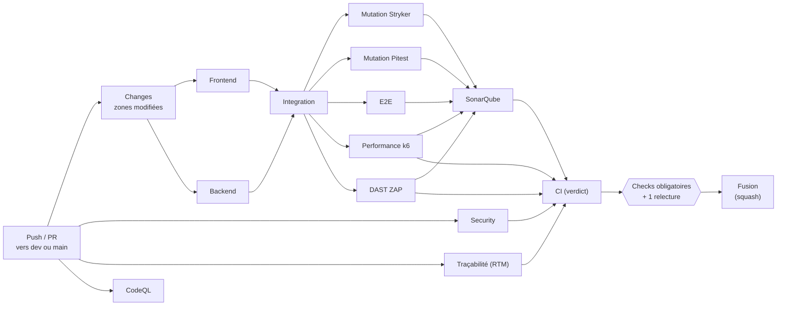

# Intégration continue (CI)

Ce qui se passe, étape par étape, entre le moment où tu pousses du code et celui où ta PR peut être fusionnée.

Fichiers de référence : `.github/workflows/ci.yml` (13 jobs), `.github/workflows/codeql.yml` (CodeQL) et, pour
les outils de qualimétrie, [quality/README.md](../quality/README.md). Les règles d'équipe sont dans
[CONTRIBUTING.md](../CONTRIBUTING.md#intégration-continue).

## Vue d'ensemble



Le pipeline avance par **paliers**, du plus rapide au plus coûteux, et **s'arrête au premier échec**
(*fail-fast*) : un palier ne démarre que si aucun job des paliers précédents n'a échoué. Inutile de lancer dix
minutes de mutation ou de tests de charge sur du code qui ne passe pas le lint.

| Palier | Jobs | Ce qu'il prouve |
|--------|------|-----------------|
| 1. Statique et unitaires | `Frontend`, `Backend` (et `Traçabilité (RTM)`, `Security`, `CodeQL` en parallèle, toujours) | le code est formaté, typé ; tests unitaires, propriétés, contrat Pact et chaos passent avec la couverture minimale ; chaque exigence est tracée |
| 2. Intégration | `Integration` | les migrations, la RLS et les triggers marchent sur un vrai PostgreSQL |
| 3. Tests dynamiques | `Mutation (Stryker)`, `Mutation (Pitest)`, `E2E`, `Performance (k6)`, `DAST (ZAP baseline)` | les tests détectent vraiment les bugs ; les parcours joueur et l'accessibilité tiennent ; performance et sécurité dynamique |
| 4. Quality gate | `SonarQube Cloud` | qualimétrie, sur la couverture produite au palier 1 |
| 5. Verdict | `CI (verdict)` | échoue si un seul job a échoué |

Dans un job, les étapes s'arrêtent aussi au premier échec, de la plus rapide à la plus lente : format → lint →
types → tests → build. Les jobs d'un même palier tournent en parallèle, chacun sur une machine Ubuntu neuve, et
vont jusqu'au bout : un seul run donne tous les problèmes du palier. Un job arrêté parce qu'un palier précédent a
échoué apparaît **« skipped »**.

| # | Étape | Job | Bloque si… |
|---|-------|-----|------------|
| 1 | Déclenchement | — | — |
| 2 | Détection des zones modifiées | `Changes` | — |
| 3 | Installation et caches | tous | — |
| 4 | Formatage et lint du front | `Frontend` | code non formaté, erreur ESLint |
| 5 | Tests unitaires et couverture du front, contrat Pact | `Frontend` | test rouge, couverture sous le seuil, contrat pas à jour |
| 6 | Build du front | `Frontend` | erreur de type TypeScript, build en échec |
| 7 | Vérification complète du backend | `Backend` | Checkstyle, test rouge (dont Pact provider et chaos), couverture JaCoCo, formatage |
| 7 bis | Matrice de traçabilité | `Traçabilité (RTM)` | exigence sans test, preuve introuvable, échec sans anomalie |
| 8 | Tests d'intégration base de données | `Integration` | migration ou règle RLS cassée |
| 9 | Tests de mutation | `Mutation (Stryker)`, `Mutation (Pitest)` | moins de 75 % de mutants tués |
| 10 | Tests de bout en bout et accessibilité | `E2E` | parcours cassé, violation WCAG 2.1 AA |
| 11 | Tests de charge | `Performance (k6)` | P95 ≥ 300 ms ou P99 ≥ 500 ms, plus de 1 % d'erreurs |
| 12 | Scan de sécurité dynamique | `DAST (ZAP baseline)` | alerte de sécurité non acceptée |
| 13 | Vulnérabilités des dépendances | `Security` | vulnérabilité « high » ou plus |
| 14 | Analyse statique de sécurité | `CodeQL` | (alertes dans l'onglet *Security*) |
| 15 | Qualimétrie | `SonarQube Cloud` | Quality Gate en échec |
| 16 | Verdict et fusion | — | — |

---

## 1. Déclenchement

La CI démarre sur :

- **chaque PR** qui vise `dev` ou `main`, à chaque nouveau commit poussé dessus. Une PR **en draft** ne lance que
  le palier 1 (`Frontend`, `Backend`, plus `Security`, `Traçabilité` et `CodeQL`) : les paliers 2 à 4 apparaissent
  « skipped ». La passer en *Ready for review* relance la CI au complet. Une draft ne se fusionne pas, donc rien
  n'est fusionné sans les paliers 2 à 4 ; on libère juste les machines (20 jobs simultanés pour tout le dépôt) ;
- **chaque push** sur `dev` ou `main`, c'est-à-dire après chaque fusion ;
- **chaque nuit à 2 h UTC** sur la branche par défaut, et à la demande (*Run workflow*) : tous les jobs tournent,
  quelle que soit la zone modifiée, et la mutation est complète (palier « nuit » : validation exhaustive). C'est
  le seul run qui rejoue **tous** les mutants (~20 min pour Stryker).

CodeQL tourne en plus **chaque lundi à 6 h UTC**, même sans changement : de nouvelles règles de détection sortent
régulièrement.

Si tu pousses un nouveau commit alors que la CI tourne encore sur le précédent, l'ancien run est **annulé**
(`concurrency: cancel-in-progress`) : seul le dernier état de la branche compte.

## 2. Détection des zones modifiées (`Changes`)

Avant tout, le job `Changes` liste les fichiers modifiés (`dorny/paths-filter`) et les range par zone. Chaque job
ne tourne que si l'une de ses zones a changé :

| Job | Tourne si ces fichiers changent |
|-----|---------------------------------|
| Frontend, E2E, Mutation (Stryker) | `frontend/**` |
| Backend, Mutation (Pitest) | `backend/**` |
| Integration | `frontend/**`, `supabase/**`, `quality/db-init/**`, `backend/pom.xml` ou le code des jeux SDV Civilisation, Dames et Tic-Tac-Toe (`backend/src/*/java/fr/tikigaming/games/{sdv_civilisation,dame,tic_tac_toe}/**`) |
| Performance (k6) | `frontend/**`, `backend/**`, `supabase/**` ou `quality/**` |
| DAST (ZAP) | `frontend/**`, `backend/**` ou `quality/**` |
| SonarQube Cloud | `frontend/**` ou `backend/**` |
| Security, CodeQL | **toujours** |

- Modifier `.github/workflows/ci.yml` relance **tous** les jobs.
- Un job non concerné apparaît **« skipped »** sur la PR, ce qui compte comme réussi.
- Si `Changes` échoue, **tous** les jobs tournent : un check n'est jamais sauté par erreur.

Exemple : une PR qui ne touche que `docs/` ne lance que `Changes`, `Security` et `CodeQL`.

### Analyse d'impact : seuls les tests des jeux touchés

`Changes` regarde aussi **quels jeux** une PR touche (sortie `games`). Si **tous** les fichiers modifiés sont dans
les dossiers d'un ou plusieurs jeux, les tests unitaires ne rejouent que ce qui les concerne :

| Fichiers d'un jeu `<slug>` | Ce qui tourne |
|----------------------------|---------------|
| `frontend/src/games/<slug>/**`, `frontend/public/games/<slug>/**` | `Frontend` : `vitest --changed`, c'est-à-dire les tests qui importent un fichier modifié, même indirectement (registre, lobby compris) |
| `backend/src/{main,test}/java/fr/tikigaming/games/<slug>/**`, `backend/src/test/resources/features/<slug>/**` | `Backend` : les tests du jeu, plus ceux du socle qui chargent tous les jeux (`config` : OpenAPI, sécurité ; `contract` : Pact provider) |
| `docs/**` | rien de plus |

- Le moindre autre fichier (socle, `registry.ts`, `src/games/{adapters,domain,testing}`, lockfile, `pom.xml`,
  migrations, CI…) fait tout tourner : on ne devine pas l'impact d'un changement partagé.
- La couverture d'un run partiel n'a pas de sens au global : les **seuils** (Vitest, JaCoCo) ne bloquent pas sur ces
  PR. Le Quality Gate SonarQube, lui, porte toujours sur le nouveau code.
- **Filet de sécurité** : chaque push sur `dev` et `main` et le run de nuit rejouent tous les tests avec les seuils.
  Un jeu qui en casserait un autre est vu au plus tard à la fusion.
- La mutation (Stryker, Pitest) est déjà incrémentale : elle ne rejoue que les mutants touchés.

## 3. Installation et caches

Chaque job part d'une machine vide, puis :

1. récupère le code (`actions/checkout`) ;
2. installe **Node 24** et/ou **Java 21** (Temurin) ;
3. installe les dépendances exactes du lockfile : `npm ci` côté front (ou restaure `node_modules` du cache, voir
   ci-dessous), Maven côté backend.

Pour ne pas refaire le même travail à chaque run, plusieurs caches sont réutilisés :

| Cache | Ce qui est évité |
|-------|------------------|
| `node_modules` du front (`.github/actions/node-modules`) | relancer `npm ci` (40 à 90 s) dans chacun des 7 jobs du front : clé = lockfile + Node + image Ubuntu ; seul le premier job qui la rate (en pratique `Frontend`) installe et sauvegarde |
| Maven | retélécharger les dépendances |
| Prettier, ESLint | revérifier les fichiers dont le **contenu** n'a pas changé |
| Navigateurs Playwright | les retélécharger tant que la version de Playwright (pas tout le lockfile) ne change pas |
| Couverture (artefacts `couverture-frontend`, `couverture-backend`) | rejouer les tests dans `SonarQube Cloud` |
| Stryker, Pitest | sur une PR, rejouer les mutants que le changement ne concerne pas |

Les caches ne changent jamais le résultat d'un check : ils accélèrent, ils n'assouplissent rien (détails dans
[CONTRIBUTING.md → Caches](../CONTRIBUTING.md#caches)).

## 4. Formatage et lint du front (`Frontend`)

```bash
npm run format:check   # Prettier : le code a-t-il le format attendu ?
npm run lint           # ESLint : TypeScript, règles des hooks React
npm run typecheck      # tsc -b : une erreur de type arrête le job avant les tests
```

Le style n'est pas discuté en relecture : c'est **Prettier** qui tranche (`frontend/.prettierrc.json`). Un fichier
non formaté fait échouer la CI. Pour corriger : `npm run format` avant de commiter.

## 5. Tests unitaires et couverture du front (`Frontend`)

```bash
npm run test:coverage   # Vitest + mesure de couverture
```

Tous les tests Vitest doivent passer, **et** la couverture doit rester au-dessus des seuils de
`frontend/vite.config.ts` :

| Périmètre | Lignes | Branches | Fonctions | Instructions |
|-----------|--------|----------|-----------|--------------|
| Cœur du lobby : `src/games/domain/**`, `errors.ts`, `scoreQueue.ts`, `sdk.ts`, `src/lib/validation.ts` | 95 % | 95 % | 95 % | 95 % |
| Tout `src/` | 78 % | 80 % | 75 % | 79 % |

Le seuil global est placé juste sous la couverture actuelle : il empêche toute régression. On le relève quand la
couverture monte, on ne le baisse jamais.

Ces tests comprennent les **propriétés et le fuzzing** (`*.property.test.ts`, fast-check) : des règles vérifiées
sur des centaines d'entrées générées, réduites au plus petit contre-exemple en cas d'échec.

Puis le **contrat Pact** (consumer) :

```bash
npm run test:contract   # tests/contract : écrit pacts/tiki-frontend-tiki-backend.json
```

Le vrai code du front (adaptateur des scores, session, client HTTP) appelle un faux backend Pact qui enregistre
chaque requête et la réponse attendue. Le contrat est versionné : si le régénérer le modifie, la CI échoue
(« Contrat Pact à jour ») jusqu'à ce qu'il soit commité, et le job `Backend` le rejoue.

## 6. Build du front (`Frontend`)

```bash
npm run build   # tsc -b (vérification des types) puis vite build
```

Vérifie que **tout le TypeScript compile** et que l'application se construit pour la production. Une erreur de
type n'importe où, même dans un fichier qu'aucun test ne couvre, fait échouer la CI.

## 7. Vérification complète du backend (`Backend`)

```bash
mvn -B spotless:check   # dans backend/ : formatage, en premier pour ne pas attendre la fin des tests
mvn -B verify
```

`mvn verify` enchaîne ensuite, dans l'ordre :

1. **Checkstyle** : imports inutiles, nommage, erreurs probables (`backend/checkstyle.xml`) ;
2. **compilation** du code et des tests (Java 21, Spring Boot 4.1) ;
3. **tests** JUnit 5, y compris ceux qui démarrent l'application complète (Swagger), dont :
   - **Pact provider** (`PactProviderTest`) : chaque interaction du contrat du front est rejouée en HTTP contre
     l'application (sécurité, CSRF, validation) ; seuls les appels à Supabase sont simulés ;
   - **chaos** (`SupabaseScoresChaosTest`) : Toxiproxy (Testcontainers) injecte latence et coupure entre le
     client des scores et un faux Supabase ; timeouts et disjoncteur doivent tenir ([SLO](slo.md#résilience--quand-une-dépendance-tombe)) ;
4. **couverture JaCoCo** : au moins 52 % des lignes et 64 % des branches sur tout le backend, et 95 % (lignes et
   branches) sur le cœur métier (`UsernameValidator`, `SupabaseErrors`, `SupabaseTokenService`, `CircuitBreaker`) ;
5. **Spotless** : le code doit être formaté (palantir-java-format). Pour corriger : `mvn spotless:apply`.

Les scénarios Gherkin Dames sont inclus dans les tests du palier 1 ; leur rapport
HTML/JSON/XML est publié dans l'artefact `rapport-bdd-dame`.

### Traçabilité (`Traçabilité (RTM)`)

```bash
npm run rtm:check   # dans frontend/
```

Lit [specs/rtm-matrix.md](../specs/rtm-matrix.md) et échoue sur toute rupture de chaîne : exigence sans cas
nominal ou sans cas d'erreur, cas rattaché à une exigence inconnue, preuve introuvable (fichier absent ou titre de
test absent du fichier), cas `FAILED`/`BLOCKED` sans anomalie, anomalie sans sévérité, priorité ou correctif. Il
tourne à chaque run, sans dépendance : renommer un test côté front ou backend casse la matrice.

## 8. Tests d'intégration base de données (`Integration`)

```bash
npm run db:check           # dans frontend/, sans Docker : noms et versions des migrations
npm run test:integration   # dans frontend/, Docker requis
mvn -B test -Dtest=SdvCivilisationTestcontainersIT -Dsurefire.failIfNoSpecifiedTests=false   # dans backend/, Docker requis
```

Deux vérifications passent d'abord, sans base de données :

- **noms et versions** (`npm run db:check`) : chaque fichier suit `AAAAMMJJHHMMSS_nom.sql` (créé par
  `supabase migration new <nom>`) et deux fichiers n'ont jamais la même version. Le runner (`npm run db:migrate`)
  identifie une migration par sa seule version : avec un doublon, le second fichier serait considéré comme déjà
  appliqué et ignoré sans bruit en production. Le runner refuse aussi un fichier dont la version est déjà appliquée
  en base sous un autre nom, avant d'appliquer quoi que ce soit ;
- **migrations déjà mergées inchangées** (sur une PR) : une migration présente sur la branche cible est déjà, ou
  sera, appliquée en production, et le runner ne rejoue jamais une version connue. La modifier, la renommer ou la
  supprimer n'aurait aucun effet en base : on crée une nouvelle migration.

L'ordre des dates, lui, n'a pas d'importance : une migration plus ancienne que la dernière appliquée est appliquée
normalement.

Le même palier exécute ensuite les `*IT` Java Dames et Tic-Tac-Toe :
`mvn -B -Pintegration '-Dit.test=fr/tikigaming/games/dame/**/*IT' test-compile failsafe:integration-test failsafe:verify` et
`mvn -B -Pintegration '-Dit.test=fr/tikigaming/games/tic_tac_toe/**/*IT' test-compile failsafe:integration-test failsafe:verify` depuis `backend/`.
Ces tests vérifient l'adaptateur avec PostgreSQL et PostgREST réels (archivage des parties vérifiées de
Tic-Tac-Toe : table `tic_tac_toe_results`, RLS, contraintes) ; leurs rapports
sont publiés dans `rapport-integration-backend`. Ils tournent après le palier 1,
avant mutation/E2E, sans rejouer toute la suite unitaire. Le filtre cible Dames et Tic-Tac-Toe :
l'étape d'intégration SDV existante est conservée et n'est pas rejouée par Failsafe.

**Testcontainers** démarre un vrai PostgreSQL (`supabase/postgres` 17.11, la même image que la production) dans un
conteneur éphémère, rejoue **toutes les migrations** de `supabase/migrations/` sur une base vide, puis vérifie
(`frontend/tests/integration/`) :

- les **règles RLS** : un joueur ne peut ni lire, ni modifier, ni effacer la sauvegarde d'un autre ; il ne peut
  pas enregistrer un score au nom d'un autre ; un visiteur n'a aucun accès aux sauvegardes ;
- les **triggers** : l'inscription crée le profil, et un pseudo déjà pris est dédoublonné ;
- le **catalogue** : les catégories du front (`GAME_CATEGORIES`) correspondent à la contrainte en base ;
- `find_auth_user_id` n'est accessible qu'au backend (`service_role`) ;
- le **stockage des parties de SDV Civilisation** (`SdvCivilisationTestcontainersIT`, JUnit) : même image, mêmes
  migrations, avec un vrai **PostgREST** devant la base, comme l'API REST de Supabase. Le vrai adaptateur
  `SupabaseGames` enregistre et relit une partie, la colonne `data` reste chiffrée, le verrou optimiste
  (`data->>version`) refuse une version périmée, et deux joueurs ne voient pas la partie l'un de l'autre. Les
  classes `*IT` ne sont pas lancées par `mvn test`.

Une migration qui ne s'applique pas sur une base neuve, ou une règle de sécurité cassée, est détectée ici, avant
d'atteindre la production.

## 9. Tests de mutation (`Mutation (Stryker)` et `Mutation (Pitest)`)

```bash
npm run test:mutation                                                     # front, dans frontend/
mvn -B -Pmutation test-compile org.pitest:pitest-maven:mutationCoverage   # backend, dans backend/
```

L'outil introduit volontairement de petits bugs, appelés **mutants** (un `<` devient `<=`, un `true` devient
`false`…), dans le code du cœur métier, puis relance les tests. Si aucun test n'échoue, le mutant a **survécu** : le
code est exécuté par les tests, mais rien ne vérifie vraiment son comportement.

- Seuil bloquant : **au moins 75 %** de mutants tués, front comme backend.
- Périmètre : le cœur du lobby côté front (`stryker.config.mjs`), les classes métier côté backend (profil
  `mutation` du `pom.xml`).
- Sur une **PR** et sur un **push** vers `dev` ou `main`, seuls les mutants concernés par le changement sont
  rejoués ; le push met à jour le cache lu par les PR suivantes. Tout est rejoué **chaque nuit** et à la demande
  (*Run workflow*).
- Les rapports HTML sont publiés en **artefacts** (`rapport-mutation-frontend`, `rapport-mutation-backend`).

## 10. Tests de bout en bout et accessibilité (`E2E`)

```bash
npx playwright install --with-deps chromium firefox webkit   # une fois
npm run test:e2e                              # dans frontend/
npm run test:e2e -- --project=webkit          # un seul navigateur
```

En CI, chaque navigateur a son job (`E2E (Playwright + axe, chromium)`, `…, firefox`, `…, webkit`), en parallèle :
chacun n'installe que son navigateur. Rapport en artefact `rapport-e2e-<navigateur>` en cas d'échec.

**Playwright** pilote les trois moteurs de rendu (Chromium, Firefox, WebKit) sur l'application, comme le ferait un
joueur (`frontend/e2e/lobby.spec.ts`, `compte.spec.ts`) :

- de l'accueil au Clicker : avertissement invité et classement ;
- une partie complète : score affiché, invitation à se connecter, sauvegarde sur l'appareil ;
- une page réservée aux comptes renvoie vers la connexion, un jeu inconnu affiche la page introuvable ;
- Supabase en panne : message lisible, le jeu reste jouable ;
- l'inscription avec Google part vers le backend ; un joueur supprime son compte (RGPD).

Le backend et Supabase sont **simulés** par interception réseau : le test ne dépend d'aucun service externe.

`frontend/e2e/accessibilite.spec.ts` passe ensuite les pages à **axe**, qui vérifie les règles **WCAG 2.0 et 2.1,
niveaux A et AA** (contrastes, libellés, structure…). En cas d'échec, le rapport Playwright est publié en
artefact (`rapport-e2e`).

## 11. Tests de charge (`Performance (k6)`)

La CI monte une copie miniature de la plateforme :

1. une base PostgreSQL (même image que la production), avec les migrations du dépôt et des **données factices**
   (1 000 joueurs, 10 000 scores : `npm run quality:seed`) ;
2. **PostgREST**, l'API REST de Supabase, avec la même RLS ;
3. le **backend Java**, avec des secrets factices : il n'appelle aucun service externe.

**k6** envoie ensuite un débit constant de requêtes (profil `load`), pendant 30 s par défaut. Les autres
profils (`smoke`, `stress`, `spike`, `soak`) se lancent en local ; objectifs et résultats dans [slo.md](slo.md) :

| Scénario | Débit | Requête |
|----------|-------|---------|
| `leaderboard` | 100 req/s | top 10 du classement, en visiteur |
| `submit_score` | 20 req/s | envoi de score par un joueur connecté |
| `session` | 50 req/s | `GET /api/auth/session` du backend |
| `rush_hour_verify` | 20 req/s | vérification serveur d'une partie de Rush Hour |
| `tic_tac_toe_verify` | 10 req/s | `POST /api/games/tic-tac-toe/verify` (script dédié `quality/k6/tic-tac-toe.js`) |

Seuils bloquants (`quality/k6/lobby.js` et `quality/k6/tic-tac-toe.js`), qui sont les SLO : **P95 < 300 ms** et
**P99 < 500 ms** pour chaque scénario, **moins de 1 %** d'erreurs et **plus de 99 %** de vérifications réussies.
Résumé en artefact (`rapport-k6`, fichiers `k6-summary.json` et `k6-tic-tac-toe.json`).

## 12. Scan de sécurité dynamique (`DAST (ZAP baseline)`)

La CI construit le front de production (avec ses en-têtes de sécurité) et démarre le backend, puis **OWASP ZAP**
explore le front (port 4173), l'API (port 8080) et le groupe OpenAPI du Tic-Tac-Toe (`/v3/api-docs/tic-tac-toe`)
et analyse leurs réponses : en-têtes manquants, CSP trop permissive, clickjacking…

- Scan **passif** (*baseline*) : ZAP observe, il n'attaque pas.
- Chaque type d'alerte est décidé dans `quality/zap/rules.tsv` : `FAIL` pour les problèmes corrigés (une
  régression fait échouer la CI), `IGNORE` pour les risques acceptés, chacun avec sa justification
  ([quality/README.md](../quality/README.md#zap--scan-dast)).
- Rapports HTML en artefact (`rapport-zap`).
- Les trois scans (front, API, groupe Tic-Tac-Toe) tournent en parallèle. Le backend est le jar construit par
  `Backend` (artefact `backend-jar`, lancé avec `java -jar`, comme pour k6) ; si `Backend` a été sauté, il est
  compilé dans le job.

## 13. Vulnérabilités des dépendances (`Security`)

Tourne **à chaque run**, même si rien n'a changé, car une faille peut être publiée sur une dépendance existante :

- `npm audit --audit-level=high` : échoue si une dépendance du front (prod ou dev) a une vulnérabilité **high**
  ou **critical** connue ;
- sur une PR, **dependency review** : refuse l'**ajout** d'une dépendance vulnérable (high ou plus), dans tout le
  dépôt.

En parallèle, **Dependabot** (`.github/dependabot.yml`) ouvre chaque lundi des PR de mise à jour pour le front et
le backend.

## 14. Analyse statique de sécurité (`CodeQL`)

`.github/workflows/codeql.yml` analyse le code source TypeScript et Java avec les requêtes
`security-and-quality` de GitHub : injections, XSS, secrets en dur, mauvaises pratiques… Les alertes
apparaissent sur la PR et dans l'onglet **Security → Code scanning** du dépôt.

## 15. Qualimétrie (`SonarQube Cloud`)

Si le secret `SONAR_TOKEN` est configuré dans le dépôt, le job :

1. récupère la couverture du front (lcov) et du backend (JaCoCo + classes compilées) produite au palier 1 par
   `Frontend` et `Backend`, sans rejouer les tests ; si l'un des deux a été sauté (zone inchangée), il recalcule
   la couverture de cette zone ;
2. envoie le code et la couverture à **SonarQube Cloud** ;
3. attend le **Quality Gate** (*Sonar way*) sur le nouveau code : 0 nouveau problème, couverture ≥ 80 %,
   duplication ≤ 3 %.

Sans secret, le job affiche un message et réussit sans rien analyser. Configuration :
`sonar-project.properties` et [quality/README.md](../quality/README.md#sonarqube).

## 16. Verdict et fusion

Le job **`CI (verdict)`** attend tous les autres et échoue si un seul a échoué : c'est le résumé du pipeline en un
check. Un job « skipped » parce que sa zone n'a pas changé compte comme réussi.

Pour fusionner une PR dans `dev` ou `main`, GitHub exige (règle « Protected ») :

- les checks **`Frontend (format + lint + build)`** et **`Backend (format + lint + tests)`** au vert, ou
  « skipped » s'ils ne sont pas concernés ;
- une branche **à jour** avec sa cible (sinon : `git pull --rebase origin dev`, puis repousser) ;
- **1 relecture approuvée**.

Ce sont les seuls blocages techniques. [CONTRIBUTING.md](../CONTRIBUTING.md#workflow) va plus loin : **une PR ne
se fusionne qu'avec une CI entièrement verte**, tous les jobs compris. La fusion se fait en *squash merge*, puis
la branche est supprimée.

Après la fusion, la CI tourne une nouvelle fois sur `dev` (étape 1) : tous les tests, seuils compris, et la mutation
incrémentale. Ce run sert de référence aux PR suivantes ; le run de nuit rejoue en plus tous les mutants.

---

## Un check échoue : que faire ?

1. Ouvre le job en échec sur la PR (*Details*) : l'étape rouge et son message disent ce qui ne va pas.
2. Pour la mutation, l'E2E, k6 et ZAP, télécharge le **rapport en artefact** (en bas de la page du run).
3. Reproduis en local avec la commande de l'étape, corrige, puis pousse un nouveau commit : la CI repart toute seule.

| Check | Cause fréquente | Correction |
|-------|-----------------|------------|
| Frontend, étape format | fichier non formaté | `npm run format` |
| Backend, Spotless | fichier Java non formaté | `mvn spotless:apply` |
| Frontend ou Backend, couverture | nouveau code sans tests | ajouter les tests (en TDD, ils existent déjà) |
| Mutation | tests qui exécutent le code sans vérifier le résultat | renforcer les assertions sur les mutants survivants du rapport |
| E2E | parcours ou libellé modifié, contraste insuffisant | ouvrir `rapport-e2e`, corriger l'interface ou le test |
| Integration | migration qui échoue sur base vide, RLS modifiée | lancer `npm run test:integration` en local (Docker) |
| Integration, migrations | deux migrations de même version, migration mergée modifiée | renommer avec `supabase migration new <nom>` ; pour une migration mergée, en créer une nouvelle |
| Security | dépendance vulnérable | mettre à jour la dépendance (souvent une PR Dependabot existe déjà) |
| Fusion impossible, checks au vert | branche en retard sur `dev` | `git pull --rebase origin dev` puis repousser |

Sur Windows, si `npm run format:check` signale **tous** les fichiers alors que la CI passe : ce sont les fins de
ligne. `core.autocrlf=true` convertit les fichiers en CRLF, alors que Prettier attend LF.
